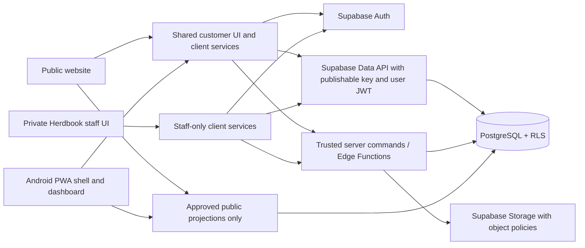

# Backend Integration Readiness Assessment

**Assessment date:** 2026-11-21

**Scope:** Read-only inspection and implementation planning. No application/database code, migration, seed, settings, or cloud resources were changed for this report.

**Evidence labels:** **Verified in code** means inspected in the current repository; **verified in local database** means queried from the running local Supabase PostgreSQL; **reported, not rerun** means stated in the supplied Task 011 brief or prior task record; **recommendation** is proposed work, not a present capability.

## Executive summary

**Recommendation: the project is ready to begin a carefully scoped local backend integration, but it is not ready for production data or for treating customer/staff workflows as online systems.** The existing local Supabase foundation is a useful security-tested start. It contains a small farm-and-animal domain, not the marketplace, account, order, auction, or full farm-management backend. The 15-page vanilla HTML site, installable Android customer PWA, and Herdbook screen all exist and should be preserved.

The customer-facing site and PWA are currently a single-origin experience with overlapping customer dashboards. They should keep sharing customer UI and services. Herdbook should remain an independently protected staff experience. Initially preserve the existing root URLs and one repository, but define these boundaries in modules and authorization now. Moving files into separate app directories can wait until routes, Auth, API contracts, and service-worker behavior are stable.

The most important implementation risks are:

1. Customer accounts, sessions, favorites, carts, orders, animal records, auction schedules, and bids are browser-local. They are not central accounts or server-confirmed business records.
2. `herdbook.html` is not private: it has no central sign-in or server-side access boundary, and its animal records are in localStorage.
3. The service worker precaches the Herdbook page and caches successful same-origin GET requests generically. Its data-cache strategy must be made explicit before a same-origin API is added.
4. The applied schema has nine RLS-enabled tables. It does not yet implement approved public listings, customer commerce, auctions, farm operations beyond animal identity, audit history, or media access rules.
5. Production region, privacy/transfer safeguards, budget, email/OAuth setup, staff provisioning, and payment/M-Pesa choices remain open.

The safest first implementation is one small vertical slice: configure a local browser client and connect the existing customer sign-up, sign-in, recovery, and session UX to Supabase Auth while preserving existing routes and leaving local prototype data untouched. Do not start with payments, bidding, live customer data, or a UI rewrite.

## 1. Current application inventory

### 1.1 Public website

**Verified in code:** 15 HTML documents are at the repository root. The public marketing and discovery pages are:

| Page | Existing role and observed behavior |
|---|---|
| `index.html` | Homepage, product/service discovery, sample/available livestock area, buying guide, and app-install prompt. Listing behavior is browser-side; it is not a public database feed. |
| `about-us.html` | Farm story, locations, mission/vision and service navigation. |
| `products-and-services.html` | Static product/service descriptions and links into the shop/catalogue. |
| `contact.html` | Contact details and enquiry form. Submitting prepares a WhatsApp message for the visitor to review and send; no enquiry is posted to a farm server. |
| `gallery.html` | Static local imagery with client-side filtering/lightbox and enquiry links. |
| `blog.html` | Static editorial guides. There is no content-management connection. |
| `auctions.html` | Auction UI backed by the same local demo auction module used by the app. |
| `shop.html` | Browser-rendered product catalogue, cart, and order-request form. It prepares an email draft; it does not create a server order or collect payment. |
| `terms-and-conditions.html`, `privacy-policy.html` | Static legal information. Current policy language describes the browser-local prototype, not the future Supabase processing model. |

The shared presentation is primarily `CSS/site.css` (about 256 KB) and `JS/site.js` (about 81 KB), with separate `JS/commerce.js`, `JS/auction-core.js`, and `JS/auction-page.js`. `site.js` contains many page-specific branches, including site navigation, install/auth flows, contact links, livestock listing, customer-account behavior, and Herdbook logic. There is no package manifest, bundler, application framework, or server/API project in the repository.

### 1.2 Customer app and account pages

**Verified in code:** The manifest starts at `app.html`; the `app.html` shell has the splash, three onboarding steps, local sign-in/sign-up forms, and the customer dashboard rendered by `JS/farm-home.js`. `customer-account.html` is a second, overlapping customer dashboard implemented mostly in `JS/site.js`. `sign-in.html` and `create-account.html` are additional account entry pages. The PWA, public pages, and these account pages use the same root origin and share some localStorage keys when run from the same origin.

Existing customer-facing UI includes home, marketplace browsing/filtering, product details, auction views/details, saved listings, profile details, local order history, enquiry dialogs, and a notification panel. This is meaningful interface work and should be carried forward. It is not yet a synchronized customer account system.

**Browser-only behavior verified in code:**

- Sign-up stores the name, email, phone, salt, and PBKDF2 password hash in `localStorage` under `savanna-customer-accounts`. Sign-in checks that same local record. The session is an email string in localStorage or sessionStorage, not an Auth access/refresh-token session.
- Google, Facebook, Apple and password-recovery controls display explanatory messages; they do not authenticate or recover an online account.
- Favorites, reminders, app onboarding/install flags, and other preferences are local browser state.
- The product/cart catalogue and some product views are shared as scripts, but the dashboards have duplicate screen/state code. The two dashboard routes should be reconciled without deleting either URL.

### 1.3 Farm management foundation

**Verified in code:** `herdbook.html` is a staff-oriented record-keeping UI with overview, animal records, marketplace/listing status, sales summary, animal creation/editing, photo selection, and local search/filter. The shared `site.js` branch stores animals in `herdbook-animals`, seeds browser demo records, and converts uploaded photos to compressed data URLs for browser storage. Website livestock views read that same local key and filter records marked `Listed`.

This is a useful management prototype, not a completed or private farm management system. There is no authentication gate on the HTML route, no server authorization, and no database synchronization. Anyone who can open the URL can reach the screen; hiding the link or adding a client-side route check will not secure the data. Preserve the screen and migrate behavior incrementally after staff Auth and authorization are available.

### 1.4 Shared files, runtime, and backends

**Verified in code:** `Assets/` contains the brand, livestock, crop, dairy, equipment, hero, splash, login, and onboarding images. The site shares one root service worker, one manifest, one stylesheet, and page-branch JavaScript. There are inline scripts on several pages, including app/auth and Herdbook pages; this matters if a restrictive Content Security Policy is introduced.

**Verified in code:** No Supabase client, project URL, browser API key, REST/RPC call, `fetch()` call, API server, Edge Function source, SQL-backed CMS, payment callback, or storage bucket policy is present in the application files. The website and app currently make no backend requests. There is no frontend automated test runner or package lockfile in the repository.

## 2. Customer commerce and auction status

### Marketplace and order requests

**Verified in code:** `JS/commerce.js` contains an in-code product catalogue, categories, descriptions and units. The cart uses `savanna-farm-shop-cart` in localStorage. Checkout creates an `MSF-*` request label, stores an “Order request prepared” record locally, and builds a `mailto:` link. Prices are generally presented as “Price confirmed by the farm.” This is a useful quote/request prototype; it is not an order accepted by the farm and it is not a purchase/payment flow.

The homepage’s public livestock area is not sourced from a database. In current browser code it uses local Herdbook data; sample records are marked demo/reference and are not authoritative inventory. The future public catalogue must read explicitly approved listing/product data, not operational animal rows.

### Auctions and bidding

**Verified in code:** `JS/auction-core.js` defines sample lots and a local schedule; `JS/auction-page.js` and `JS/farm-home.js` render countdowns and bidding UI. Bid rows and bidder IDs are written to localStorage. The bidder identity is generated in the browser and sometimes scoped to the local email-string session; it is not a verified customer identity. The public pages mask the bidder identity in presentation, but local storage and developer tools expose the client-side records. Countdown status is derived from each browser’s `Date.now()` and does not close a server lot.

Therefore, current bids cannot be treated as accepted, confidential, durable, or synchronized across devices. The winner/result and “contact the farm after close” flow must be driven by server state. The existing interface and sample-lot specifications can remain as UX prototypes; local preview bids must never be imported as accepted bids.

### Enquiries and notifications

**Verified in code:** Contact, listing, and customer-dashboard enquiries open a prefilled WhatsApp link; shop checkout opens an email draft. They are not centrally recorded or assigned to staff. The app notification area and auction reminders are local UI/state; no push subscription, notification delivery service, or server-side notification store is connected.

## 3. PWA and offline assessment

**Verified in code:** `manifest.webmanifest` uses `app.html` as `start_url`, root scope, standalone display, the farm icon, and green theme colors. `JS/site.js` registers one root `service-worker.js`. The worker has a versioned app-shell cache; it precaches all root HTML pages, including `herdbook.html`, and the JS/CSS/manifest/icon files. Navigation and code are network-first with cached fallbacks; other successful same-origin GETs are cached and served cache-first. Large photos are fetched and cached on first use.

**Integration risks:**

- The current worker has no API-specific cache allow/deny rules. Same-origin authenticated API GET responses could enter its generic GET cache if a future API/reverse proxy shares the site origin. Supabase-hosted cross-origin requests are currently outside this worker’s origin check, but that does not secure data or solve offline behavior.
- Herdbook is precached as a static page. The page contains no server data today; once staff authorization exists, do not imply that a cached HTML document itself is protected. Gate every data operation server-side and reconsider staff route precaching.
- Private customer and staff API responses must be network-only initially and excluded from Cache API, navigation fallback, and precache. Clear in-memory account data on sign-out/account change. Cache only approved public catalogue/content with an explicit freshness label and bounded retention.
- Do not queue/replay bids, order submission, payment, publication, inventory, or finance writes offline. Only show “submitted/accepted” after the server returns a durable record and status.
- The worker caches app code but the stylesheet imports Google Fonts and some backgrounds use external Unsplash URLs. Those resources are not guaranteed offline; use local approved assets/fonts or provide documented fallbacks if full offline appearance is a requirement.
- Browser storage is device/origin-specific and can be cleared, unavailable, or edited. Keep it as an explicitly labeled draft/cache, never as the source of truth.

**Recommendation:** Keep one customer-facing root worker and the current install URL during the first integration phases. Add route/data classes and tests before introducing API reads. If serving pages locally, use localhost/HTTPS rather than opening an HTML document through `file://`; service workers and secure Auth behavior need a supported web origin.

## 4. Supabase and database readiness

### Verified local state

**Verified in local database on 2026-11-21:** The existing local Supabase PostgreSQL container is healthy and has migration history entries `20261120000100` and `20261120000200`. The nine tables in the first migration all have RLS enabled. The seed database has five synthetic animal records. No hosted project was queried or linked during this assessment.

The implemented tables are:

`farms`, `farm_locations`, `user_profiles`, `farm_memberships`, `role_permissions`, `species`, `breeds`, `animals`, and `animal_identifiers`.

The first migration provides farm-scoped read/create/update animal policies, identifier read/create policies, self-profile policies, membership reads, public active species/breed catalogue reads, and a fixed-search-path `SECURITY DEFINER` membership helper. The second migration grants the `authenticated` database role column-level INSERT on `animals.id`, needed for the deterministic test insert. Grants and RLS work together: grants authorize an operation/column; RLS decides which rows qualify. Supabase’s guidance explicitly calls for both and for tests for every exposed table. [Supabase RLS guidance](https://supabase.com/docs/guides/database/postgres/row-level-security)

Role inspection confirmed `anon` and `authenticated` do not bypass RLS; local `service_role` does bypass RLS and has broad table access. No service key belongs in browser code. Supabase documents that secret/service keys bypass RLS and must remain server-side. [Supabase secrets guidance](https://supabase.com/docs/guides/functions/secrets)

**Reported, not rerun for this assessment:** The supplied Task 011 brief states that `npx.cmd --yes supabase test db --local` passed `Files=1, Tests=64`, and that both migrations were recorded. The migration history was independently checked here; the official CLI suite was not rerun in this inspection-only task. The prior work in this thread also executed the full 64 assertions directly against local PostgreSQL and reported all passing after the permission fix.

### What is missing from the implemented schema

All names below are present only in the proposed `DATABASE_SCHEMA.md`/API architecture or roadmap, unless listed in the nine-table implemented set above. Do not describe them as working database features yet.

| Capability | Required additions before the related feature is real |
|---|---|
| Customer/public identity | Customer saved items, customer enquiry ownership, possibly distinct customer profile/preferences; central Auth flows and verified contact state. A customer is an Auth identity without a farm membership; no customer should become staff through client-controlled role data. |
| Animal operations | Ownership history, pedigree, health records, treatments, veterinary visits, breeding events, pregnancies, births/offspring, feeding records, and general farm activities, with farm-scoped policies and retention. |
| Catalogue and publishing | Product categories/products, livestock listing projections, approval/publishing state, content pages only if a CMS is wanted, public read views/functions with allow-listed fields. |
| Commerce | Enquiries, orders, immutable order item/price snapshots, status history, fulfilments, payment transactions, provider callback/reconciliation records, idempotency records, and audit events. |
| Auctions | Events, lots, bidder eligibility/private bidder records, immutable bids, close results, notifications, idempotency and audit records. Must support locking/atomic bids and close transitions. |
| Inventory and purchasing | Inventory items, immutable stock movements, suppliers, purchases and purchase items, receiving/adjustment authorization. |
| Finance and reporting | Accounts/categories, balanced transaction headers/lines, immutable posting/reversal and source reconciliation. |
| Media | File metadata and classification plus Storage buckets/policies, upload-intent/approval workflow, MIME/size validation, malware scanning, and public/private separation. |
| Operations | Audit trail, idempotency, rate limiting/abuse controls, retention/deletion process, backup/restore, monitoring and incident workflow. |

The nine-table pgTAP suite is valuable evidence for the base farm/animal security model. It does not prove the unimplemented domains above are secure or production-ready. Every added table/view/function/storage policy needs explicit grants/RLS, relevant positive and negative tests, and abuse/concurrency tests as applicable. A view can have different RLS behavior from its base tables; review it as a separate API surface.

### Current documentation discrepancy

**Verified:** `supabase/README.md` and several architecture/security notes contain environment statements from 2026-11-20 saying there were no containers, no local DB, no applied tests/migrations, or no `supabase/.temp`. Those statements no longer match the running local environment observed in this assessment. `docs/architecture/SECURITY_AND_DEPLOYMENT.md` also says the tests and database were not yet verified. Task 011 allows only this report file to be created, so those documents were not edited. Reconcile their dated status claims in a later documentation-maintenance task.

## 5. Application boundaries and recommended target

**Recommendation:** Keep one repository and all current URLs while starting logical separation. Do not create a third customer app. Do not force a physical folder restructure before the data/auth contracts and URL compatibility plan are proven.

The diagram is the **proposed** target, not current wiring. Browser clients may use a publishable/anon key only with RLS and safe public projections. Trusted server functions own secrets and operations that require atomic transitions, external payment/email integrations, or elevated membership administration. The database remains the shared system of record.

| Logical area | Keep/own now | Future physical organization after contracts stabilize |
|---|---|---|
| Website and customer PWA | Existing root public pages, `app.html`, `customer-account.html`, `sign-in.html`, `create-account.html`, shared customer modules, one manifest/worker | Could become `apps/customer/` with website content and PWA shell as routes/build outputs, not two independently implemented customer systems. Preserve old URLs with aliases/redirects and test install/return paths. |
| Farm management | `herdbook.html` and staff-only modules, distinct navigation and session/permission behavior | `apps/farm-management/` if there is a build/deployment reason. It may share packages/utilities but not customer state or navigation. |
| Backend | Existing `supabase/` config, migrations, seed and DB tests | Keep shared Supabase project/schema and server functions; domain directories may be introduced as the number of migrations/functions grows. |
| Shared UI/data helpers | Move only truly generic design tokens, safe formatters, and stable API types; business authorization and domain rules stay with their domain/backend | A small shared package only after boundaries stabilize. Do not duplicate one customer's cart/auth/auction state across separate frontends. |

**URL and migration compatibility:** Root HTML URLs currently feed navigation, search/share links, legal return links, manifest start URL, and service-worker scope/cache paths. Keep these paths until redirects and Android update behavior are tested. If files move later, update all links, cache URLs, manifest start/scope/icon paths, navigation, hosting rewrites, redirect/canonical tags and test old installed clients. Do not clear or silently import prototype localStorage during cutover; provide an export/mapping and reconciliation process. Do not treat local passwords, demo animals, or local bids as verified server records.

## 6. Authentication and authorization design

**Recommendation:** One managed Auth identity can be both a customer and a staff member. Authentication establishes identity; customer ownership and active farm membership/permission determine authorization. Farm membership is not a customer role, and a customer account must never imply farm access.

| Actor | Intended access | Required enforcement |
|---|---|---|
| Anonymous visitor | Published public content, published listings/products/auctions, rate-limited enquiry | Explicit public views or API functions; never raw access to animal, profile, bid identity, order, finance, or staff tables. |
| Customer | Own profile, favorites, enquiries, orders, bids, notification preferences; public content | Auth JWT and user_id ownership RLS/API checks; every direct-ID route tested against a second customer. |
| Employee | Assigned farm data and narrowly assigned operations such as animal read/create and identifier create | Active `farm_memberships` row plus explicit permission per farm and record. Never grant all operations because someone is “staff.” |
| Manager | Manager-level farm operations and explicit approval scope | Farm membership plus permissions; cross-farm reads remain denied. Sensitive approval actions are audited. |
| Owner | Full business oversight within their farm, with sensitive admin operations performed through trusted code | Farm-scoped policies; membership/role changes via a restricted server/admin path, not browser role-table grants. Preserve audit history and require strong account protection. |
| Platform operator, if needed | Limited operational/support access across tenants only for defined duties | Separate server-side operational role, just-in-time access, audit, MFA, and no ambient browser service key. Decide whether this role is needed before implementation. |

### Authentication lifecycle

- **Customers:** Supabase Auth email/password registration and sign-in, email verification, reset-password, refresh/session handling, sign-out, and account deletion/request process. Use the supported client library/PKCE flow; provider redirect URLs and email sender must be configured. Supabase Auth PKCE is a one-time, short-lived code exchange; use the documented client flow rather than hand-written password/session storage. [Supabase PKCE flow](https://supabase.com/docs/guides/auth/sessions/pkce-flow)
- **OAuth:** Google/Facebook/Apple buttons stay disabled or clearly marked unavailable until each provider application, secrets, callback URLs, consent copy and redirect behavior are configured and tested. The current buttons are visual prototype controls.
- **Staff:** Owner/trusted administrator invites a person, assigns an active membership and permissions server-side, and can disable/revoke it. A public sign-up form cannot create or upgrade a staff membership. The current schema has no staff-invite/admin route.
- **Recovery:** Central Auth recovery over a verified email address, short-lived reset links, rate limits and generic responses that do not disclose whether an email exists. Support contact is not a substitute for credential reset.
- **Private pages:** `herdbook.html` can remain a static URL, but it must hydrate only after a valid session and the database/API must independently enforce every read/write. A route guard improves UX only; it is not a security boundary.
- **Shared device:** Provide explicit sign-out, session-expiry handling, no private response caching, and a clear way to remove local prototype data after a separately confirmed migration. Staff field devices need a stricter timeout/session posture than casual public browsing.

Supabase’s browser/server guidance supports the managed client flow; keep access control in the database and trusted server operations. The user JWT must carry the verified user identity; do not accept user ID, farm ID, role, bid owner, price, or order total as trusted merely because the browser submitted it.

## 7. Marketplace publication workflow

**Recommendation:** Separate an operational animal record from a curated public listing. Do not make a public listing by allowing `anon` or customers to select from `animals`.

1. Authorized staff creates or edits an animal under an assigned farm; server/database checks `animal.create/update`, identifier uniqueness, and tenant ownership.
2. Staff creates a draft livestock listing with explicitly public title, description, price mode, availability, public location label and selected media. Keep health notes, internal notes, precise private address, owner/staff identity and internal identifier data private.
3. A manager/content publisher reviews changes and approves publication. Record approver, timestamp, version and any price/availability decision in an audit trail.
4. Website and PWA query only published listing/product projections. Unpublished, withdrawn, sold, expired, archived, or otherwise ineligible items return no public record (prefer 404 for a direct hidden listing ID).
5. Customers can view, save, ask about or request an order. Customer identity and personal details are stored only when needed and are visible only to that customer and authorized staff.
6. Farm changes stock/sale/withdrawal state through an authorized operation that updates the listing projection and retains history. Public availability is never inferred from an old browser cache.

The proposed schema already describes `products`, `livestock_listings`, `product_categories`, and `content_pages`; these are proposals, not applied tables. Public API responses should explicitly enumerate fields. Do not expose an unfiltered Postgres view: views require their own RLS/security review.

## 8. Orders, payments, and auctions

### Orders and payment

**Recommendation:** Ship an order-request flow first and keep payment disabled until farm policy and provider setup are decided. The server must recompute price, availability, quantity, fulfilment and totals at submission. Save an immutable item/price snapshot, request status and idempotency result in one transaction. An email/WhatsApp draft or browser cart is not an order accepted by the farm.

Payment is a separate state machine: order request/quote → accepted order → payment attempt → provider-verified settlement → fulfilment. A redirect or screenshot is not payment confirmation. Verify callback signatures, deduplicate provider event IDs, reconcile provider settlement against internal records, and support failure, timeout, refund/reversal and manual reconciliation. Keep card/mobile-money provider credentials server-side; no raw card details in this application.

For Kenya, M-Pesa is a possible rail, not an integration already selected. Safaricom’s official Daraja portal provides M-PESA APIs and sandbox testing; evaluate Daraja directly or a suitable licensed/contracted payment partner for fees, settlement, callback security, support and commercial eligibility before choosing. [Safaricom Daraja Developer Portal](https://developer.safaricom.co.ke/). Credentials and callbacks belong in a trusted server function, not website/PWA JavaScript.

### Auction and bidding

**Recommendation:** Keep website and PWA views on one auction API and one database model. A trusted database transaction/function or server endpoint must lock/version the lot, validate eligibility, use server time, calculate the next minimum bid, insert an immutable bid and update the visible high amount atomically. Use idempotency for retry after an ambiguous mobile connection. Race/close tests must prove no bid is accepted at or after authoritative close time.

Store bidder identity in a private table. Public auction reads may expose allowed amounts and limited timestamps but never bidder user ID, email, phone or private eligibility notes. Staff bidder lists require a specific permission and audit. Closing creates an idempotent result/winner record; only after that result is final should the authorized farm workflow contact the winner. The client countdown is display-only and must reconcile to server state.

## 9. Security, storage, privacy, and operational readiness

### Security controls to implement

- Put RLS, grants, constraints, indexes and tests in each migration. Revoke unnecessary defaults for every new table/view. Test anonymous, customer A/B, staff same/other farm, disabled user, owner and direct-ID paths.
- Use only a publishable/anon browser key with RLS. Keep service/secret keys in Supabase function secrets or another trusted server secret store. Never place them in HTML, JavaScript, images, PWA config, or committed environment files.
- Use Edge Functions or narrowly scoped Postgres functions for staff invitations, publication approval, order creation, bid acceptance/closing, payment callbacks, email/notifications and any operation that requires secrets or cross-row atomicity. A browser client is not a trusted administrator.
- Validate and encode all inputs at both API and database boundaries. Apply field length, MIME/type/size, enum, money integer, ownership and transition checks. Rate-limit sign-up/recovery, enquiries, bid attempts, uploads and payment callback endpoints; add abuse controls appropriate to public endpoints.
- Create an append-only audit event for membership/permission changes, listing approvals, order/payment transitions, auction bids/results, inventory adjustments and finance posting. Exclude passwords, tokens, raw payment secrets, and unnecessary personal details.
- Add backups, restore exercises, error monitoring, alerting, structured request IDs and an incident/credential-rotation runbook before live transactions.

### Storage and media

The local Supabase stack includes a Storage service, but the repository does not define farm application buckets or object access policies. Herdbook photos are currently data URLs in localStorage, not Storage objects. Create private-by-default staff media storage; upload through an authorized path; use object RLS scoped to farm and operation. Approved public media should be copied/approved into a separate public projection or bucket, with no private animal document sharing. Validate actual bytes, file size/type, image dimensions and malware/scanning policy; avoid trusting a client-supplied extension or content type. Supabase Storage uses RLS over `storage.objects`; public buckets intentionally make object retrieval public. [Supabase Storage access control](https://supabase.com/docs/guides/storage/security/access-control), [bucket access models](https://supabase.com/docs/guides/storage/buckets/fundamentals).

### Kenya data-protection review

Customer/employee contact details and account information are personal data. Before sending real data to a hosted region, identify controller/processor roles, data categories, purposes, retention, rights handling, subprocessors and actual processing locations. Kenya’s Data Protection Act addresses transfers outside Kenya in sections 48–49; the ODPC’s current cross-border guidance discusses safeguards and transfer conditions. Obtain owner/data-protection review for the chosen provider/region and any applicable registration or assessment obligations before production data. This report is an engineering assessment, not legal advice. [Kenya Data Protection Act, Part VI](https://new.kenyalaw.org/akn/ke/act/2019/24/eng%402019-11-15/source), [ODPC cross-border transfer guidance](https://odpc.go.ke/wp-content/uploads/2026/09/ODPC-%E2%80%93-Guidance-Notes-for-Cross-border-Data-Transfers.pdf), [ODPC data-protection laws](https://www.odpc.go.ke/data-protection-laws-kenya/).

The current privacy policy says account information remains in local browser storage and is not sent to a farm account database. Once central Auth, analytics, email, Storage, payments or notifications are introduced, revise the policy and consent/notice before launch to accurately list processors, purposes, retention, transfers and customer choices. Do not retain old prototype copy as if it described the live service.

## 10. Phased implementation roadmap

Each phase is incremental; the public marketing pages, static guides/gallery, existing customer routes and current design can remain useful while backend domains are added.

| Phase | Build and existing pages | Backend entities/services | Security and dependencies | Tests and completion criteria |
|---|---|---|---|---|
| **1. Integration preparation and client configuration** | Add a small, reusable vanilla-JS backend client/config boundary; keep root routes, CSS and visual design. Establish local/staging/prod configuration split and a supported localhost dev server. Document public vs authenticated requests and loading/error/offline states. | Existing local Supabase project, current migrations, a non-secret project URL/publishable key config; pinned Supabase browser client if required. No new business tables for this setup slice. | Local-only first. Never add service-role/secret keys to browser config. Keep secrets out of Git. Confirm origin/redirect allowlists; no remote link or live data as part of local work. | Smoke test local Auth/API reachability, missing config behavior, offline behavior and no-key leak in built source. Preserve all page URLs and app install start URL. |
| **2. Authentication and authorization** | Connect `app.html`, `sign-in.html`, `create-account.html`, `customer-account.html`, then protect `herdbook.html` data paths. Reuse shared auth helpers; preserve splash/onboarding and compatibility routes. | Supabase Auth; existing `user_profiles`; server-only staff invite/membership administration. Add needed audit event support before production staff onboarding. | Customer identity is not staff membership. Disable local prototype login as an authority; never auto-import local password hashes. Staff membership is set by trusted owner/admin path, not client input. Require email verification/recovery and configure real sender/OAuth providers before production. | Anonymous/customer A/customer B, session refresh/logout/recovery, email confirmation, direct URL, disabled staff, other farm, role escalation and missing membership tests. Acceptance: customer has same Auth identity across website/PWA; staff data requests fail without active permission. |
| **3. Farm management core and livestock records** | Evolve `herdbook.html` and its `site.js` branch in place. Retain overview, search/filter, animal add/edit/status and photo workflow; replace local data source behind the same screen incrementally. | Existing `farms`, `farm_locations`, `species`, `breeds`, `animals`, `animal_identifiers`; then animal histories/operations as needed. Storage metadata and private media bucket for photos. | Every query binds to active farm membership and permission; stable database IDs; never trust supplied farm/creator IDs. Preserve a sanitized local export and reconcile before import. | RLS CRUD allow/deny by employee/manager/owner/other farm, identifier uniqueness/FKs, upload security, errors, conflict/version behavior and import reconciliation. Acceptance: staff records persist across devices; no staff data appears to anon/customer. |
| **4. Public livestock/product publication** | Connect homepage livestock cards, `products-and-services.html`, `shop.html` catalogue read, and `auctions.html` public listing reads only after approval workflow exists. Preserve static descriptions and URLs as fallback. | `products`, `product_categories`, `livestock_listings`, optional `content_pages`, publication/media approval and audit. Public views/functions with explicit fields. | Separate animal record from listing; manager/authorized publisher approval; no direct public select on `animals`, health, or private storage. Hide drafts/withdrawn/sold records even by direct ID. | Public anonymous read tests for draft/published/withdrawn, field allowlist and direct-ID access; approval actor tests and stale cache tests. Acceptance: only approved listing data is public and source record remains private. |
| **5. Customer accounts, marketplace, and enquiries** | Consolidate duplicate customer dashboards carefully: keep `app.html` as PWA launch shell and select one dashboard implementation after screen-map review; preserve `customer-account.html` compatibility URL. Connect favorites/profile/enquiries and customer marketplace to shared services. | `user_profiles`, customer saved-items and `enquiries`, approved listings/products APIs, optional notifications foundation. | Own-user policies for every profile/save/enquiry; anonymous enquiry abuse/rate limits; never trust local email as identity. Enquiry is a request, not a purchase. | Cross-customer IDOR, anonymous abuse, validation/escaping, duplicate saves, account switching, and desktop/mobile route tests. Acceptance: same favorites/profile on website and PWA after login; farm receives an auditable enquiry. |
| **6. Orders and commerce** | Connect `shop.html`, product/detail routes and customer app cart/checkout; cart can remain a local draft. Add customer order history and staff order view in Herdbook. | `orders`, `order_items`, `order_status_history`, `fulfilments`, `payment_transactions`, idempotency, audit; email or notification delivery. | Recalculate prices/availability server-side; store KES integer minor units and line snapshots; idempotent submit and validated state transitions. Payment is separate and starts disabled until farm chooses provider/commercial terms. Webhook signatures and settlement reconciliation. | Duplicate submit/retry, price tampering, stock changed, customer A/B, staff permissions, payment callback replay/failure/refund/timeout. Acceptance: user sees a server order ID/status; no “paid” until verified settlement. |
| **7. Auctions and bidding** | Wire `auctions.html` and app auction list/details/my-bids to one shared server-backed interface. Keep current sample cards only as visibly labeled fixtures until live lots are approved. | `auctions`, `auction_lots`, private `auction_bidders`, immutable `bids`, `auction_results`, idempotency, notifications and audit. | Server time and atomic row lock/version; eligibility and increment checked server-side; public response exposes amounts only; staff bidder list permission-gated. Winner contact only after server close result. | Concurrent bids, two bidders at same amount, close-boundary race, idempotent retries, direct-ID/customer isolation, bidder privacy and closure retry. Acceptance: cross-device consistent bids and result, client countdown only advisory. |
| **8. Farm operations: health, breeding, feeding, inventory, suppliers** | Extend Herdbook modules without replacing its shell: health/treatments/vet, breeding/pregnancy/birth, feeding/activities, inventory movements, supplier and purchasing views. | `health_records`, `treatments`, `veterinary_visits`, `breeding_events`, `pregnancies`, `birth_records`, `birth_offspring`, `feeding_records`, `farm_activities`, `inventory_items`, `stock_movements`, `suppliers`, `purchases`, `purchase_items`. | Domain-specific least privilege; sensitive records private; stock balance derived from immutable movements; approvals and adjustment reason. | Farm isolation, staff permission matrix, FK/domain checks, parent-cycle constraints, stock movement/reversal/concurrency and export tests. Acceptance: immutable history is auditable and no public read exposes operations. |
| **9. Financial records, employees, reports** | Add permissioned finance, employee/access administration, audit review, and reports to Herdbook. Build on—not replace—the existing staff overview. | `finance_categories`, `finance_accounts`, `financial_transactions`, `financial_transaction_lines`, role permissions, audit events and report functions; complete staff invite/disable path. | Finance posting/reversal is server-only/transactional and balanced; no silent edits to posted records; sensitive report roles explicit; multi-step admin actions audited and MFA where supported. | Balanced journal, reversal, concurrency, role escalation, disabled user, audit immutability and report scopes. Acceptance: totals reconcile to orders/purchases/auction records; employee access changes are attributable. |
| **10. PWA synchronization, notifications, performance, production readiness** | Preserve install, splash, onboarding, current routes and single worker; add explicit connection/stale states, push/in-app delivery as supported, safe static offline use, and graceful update behavior. | Push subscription/notification delivery, public cache validators/version fields, server request IDs, monitoring/backups; no offline mutation queue for authoritative actions. | Keep customer/staff API responses out of Cache API and shared caches. Only public approved content can be cached, labeled stale. Choose host/region after privacy and Kenya latency review. | Android install/update, service worker upgrade/rollback, offline public browse, sign-out/cache isolation, no private cache, notification consent, load/performance, backup restore, security review and staging rollback. Acceptance: actions are clearly pending until server-confirmed and operations are recoverable. |

### Dependencies and parallel delivery

- Phase 1 is the common prerequisite. Phases 2 and 3 are the critical path for a real staff tool; phases 2, 4 and 5 are the path for a synchronized customer experience.
- Public static marketing content and accessibility/performance improvements can continue independently, provided URLs and assets are preserved.
- Product/listing read APIs can be built alongside Herdbook data integration after the publication and security contract is agreed.
- Orders and auctions can be separate vertical slices after Auth and public catalogue contracts; they must share currency, identity, idempotency, audit and status-transition conventions.
- Health/inventory and customer content should not wait for payments. Payments should wait for provider/settlement decisions; finance posting should follow reliable order/inventory source events.

## 11. Testing and acceptance strategy

### Database and API tests

1. Keep the existing 64-assertion base suite as regression coverage. Do not describe it as a full-platform audit.
2. For every new table/view/function: assert grants plus RLS for anon, customer A/B, employee, manager, owner, disabled staff, cross-farm ID and service-role-only command paths.
3. Assert the public API’s exact fields. Test that private columns and records are absent, not merely hidden in the UI.
4. Test business constraints and transactions: duplicate identifier, tenant ownership, product publication, stale version, order price/quantity, inventory movement, bid increment/close race, idempotency replay, payment callback verification and result close.
5. Use only synthetic `.invalid` accounts and fixture data in local/staging tests. Run migrations in a clean disposable environment only through an explicitly planned safe workflow; do not reset the user’s current local data casually.

### Browser/PWA journeys

- Public visitor: homepage → product/listing → contact/enquiry; direct API URL manipulation; unauthenticated private URL/data checks.
- Customer: sign-up/verify → sign-in/recovery/sign-out → browse/save → order request/status → bid/my bids/result on both website and Android PWA.
- Staff: invite/accept → sign in → create animal/identifier/photo → draft/approve listing → update availability/order → close auction; repeat with employee, manager, owner, disabled and other-farm sessions.
- Offline/update: fresh install, old installed version, failed worker install, navigation fallback, stale public data label, private response cache inspection, account switch and reconnect after a pending action.
- Keep endpoint/API contract tests and browser E2E checks for critical journeys. Do not claim success from DOM rendering alone; assert persisted records and denied cases via a second identity.

## 12. Risks, gates, and recommended next task

### Important risks and unresolved decisions

| Risk/decision | Why it matters | Gate/owner |
|---|---|---|
| Production provider, processing region, transfer safeguards and Kenya latency | Real customer/staff personal data may be hosted outside Kenya; legal/operational fit and latency are unverified. | Farm owner + data-protection reviewer before hosted personal data. |
| OAuth/email sender | Registration confirmation, recovery and social buttons cannot work without provider setup and verified sender/redirects. | Farm owner/IT before production customer sign-in. |
| Staff membership bootstrap and roles | Migration has no browser-safe way to create/invite owners or assign roles. | Define trusted initial owner bootstrap and audited staff provisioning before staff rollout. |
| Dashboard canonicalization | Two customer dashboards overlap and route state differs. | Approve a screen/route compatibility map before consolidation; do not delete either page. |
| Payment and M-Pesa operating policy | Fees, settlement, reversals, reconciliation, callback source and legal terms affect schema and order state. | Farm/finance owner and chosen provider before accepting live payment. |
| Auction commercial rules | Eligibility/deposit, reserve, extensions, tie handling, no-sale, cancellation, default and winner contact need decisions. | Farm owner before live bidding. |
| Migration of browser records | Prototype data and photos may be real or demo, and local sessions are not identity proof. | Export/review/map records; customer resets or verifies centrally; no silent import. |
| Service-worker cache boundary | Generic same-origin GET caching could leak a future private API response on a shared device. | Add API denylist/network-only behavior and logout tests before backend reads. |
| Database/docs drift | `supabase/README.md` and architecture notes have stale local status claims. | Reconcile docs as a separate documentation task, preserving the requested scope of this report. |
| No frontend build/test harness | There is no lockfile/module bundling or repeatable browser E2E entry point. | Choose a minimal reproducible JS packaging/test approach during Phase 1; do not adopt a UI framework without evidence. |

### Exact recommended next development task

**Task 012 — Local customer Auth vertical slice (no commerce or staff migration yet).**

1. Add a small shared Supabase client/config module for the existing vanilla frontend, pinned to the official supported client library if needed. Use local project URL and publishable/anon key only; keep secret/service keys out of browser and Git.
2. Connect the existing `app.html` and `sign-in.html`/`create-account.html` flows to email sign-up, email verification, sign-in, session refresh, reset-password and sign-out. Keep Google/Facebook/Apple controls unavailable until provider configuration is supplied.
3. Use the current `user_profiles` self-service rules for safe profile creation/update; do not add customer access to staff tables or let the client create farm memberships.
4. Preserve `app.html`, `customer-account.html`, `sign-in.html`, `create-account.html`, manifest start URL, existing visual design and old route behavior. Decide one shared auth module but defer full dashboard merge.
5. Leave all current localStorage data intact and label it prototype-only. Do not migrate local passwords, sessions, bids, animals, or “orders” as if they were verified. Provide an explicit local-data export/cleanup path only after a separate migration decision.
6. Add tests for anonymous, verified customer, customer A/B, session/recovery, profile self-access, disabled staff, no membership escalation, service-worker/private-cache behavior, and missing/bad local config.
7. Acceptance: a customer can create/verify/sign in on one device and use the same account on another; their profile comes from the backend; anonymous/direct-ID reads of private records and all customer attempts at staff membership/animal operations are denied; no secret key appears in browser sources; existing URLs and PWA install behavior still work.

This first slice validates the browser-to-Auth boundary without tying the project to unsettled product, payment, or auction rules. Then extend the same identity/data client into Herdbook and approved listing publishing.

## 13. Skills and sources used

**Skills actually used:** The project’s `architecture` skill was read and applied to boundaries, evidence, dependencies and decision gates. Repository context was gathered directly from all root page entry points, shared JS/CSS, service worker, manifest, Supabase configuration/migrations/seed/tests and architecture documentation. No application implementation or test skill was needed because this task is inspection and planning only.

**Skills available but not invoked:** The project environment contains `context-engineering`, `domain-modeling`, `spec`, `breakdown`, `code-review`, `debugging`, `e2e-testing`, `a11y-review`, `replica-backend`, and other general/replica workflows. There is no dedicated Supabase migration/integration skill in `.agents/skills`; official Supabase documentation was used for RLS, secret, Auth PKCE and Storage constraints. `replica-backend` was not used because this is the existing Marks Savannah Farm platform, not a third-party app clone.

**External sources checked:**

- [Supabase Row Level Security](https://supabase.com/docs/guides/database/postgres/row-level-security)
- [Supabase Edge Function secrets](https://supabase.com/docs/guides/functions/secrets)
- [Supabase Auth PKCE flow](https://supabase.com/docs/guides/auth/sessions/pkce-flow)
- [Supabase Storage access control](https://supabase.com/docs/guides/storage/security/access-control) and [bucket fundamentals](https://supabase.com/docs/guides/storage/buckets/fundamentals)
- [Safaricom Daraja Developer Portal](https://developer.safaricom.co.ke/)
- [Kenya Data Protection Act, Part VI](https://new.kenyalaw.org/akn/ke/act/2019/24/eng%402019-11-15/source)
- [ODPC cross-border transfer guidance](https://odpc.go.ke/wp-content/uploads/2026/09/ODPC-%E2%80%93-Guidance-Notes-for-Cross-border-Data-Transfers.pdf) and [ODPC data-protection laws](https://www.odpc.go.ke/data-protection-laws-kenya/)

## Final readiness decision

**Start local backend integration after Phase 1 preparation, beginning with customer Auth.** The repository has real existing site/PWA/Herdbook work and a working local database security foundation; it does not yet have connected application data, secure customer authentication, a private staff application, approved public listing entities, commerce, or server auctions. Continue from the existing pages and local migrations. Keep the public site/PWA logically shared, Herdbook logically and authorization-wise separate, and the backend shared. Do not load production personal data or enable payments/live bids until the open privacy, provider, staff-provisioning and business-rule gates are resolved.
